# Manual de usuario — Kuentas

> Guía para el contador que usa Kuentas en su trabajo diario. Está escrita en el
> orden en que se usa el sistema: primero se configura la empresa, después se
> registran los movimientos y al final se emiten los libros y los informes.

| | |
|---|---|
| **Versión del manual** | 1.0 — octubre de 2026 |
| **Sistema** | Kuentas · plataforma contable en la nube |
| **Dirigido a** | Contadores y asistentes contables |

---

## Índice

1. [Primeros pasos](#1-primeros-pasos)
2. [Puesta en marcha de una empresa](#2-puesta-en-marcha-de-una-empresa)
3. [Maestros: con quién trabaja la empresa](#3-maestros-con-quién-trabaja-la-empresa)
4. [Registrar movimientos](#4-registrar-movimientos)
5. [Compras, ventas y honorarios](#5-compras-ventas-y-honorarios)
6. [Libros oficiales](#6-libros-oficiales)
7. [Informes y balances](#7-informes-y-balances)
8. [Cierre del período](#8-cierre-del-período)
9. [Herramientas de apoyo](#9-herramientas-de-apoyo)
10. [Preguntas frecuentes](#10-preguntas-frecuentes)

---

## 1. Primeros pasos

### 1.1 Ingresar al sistema

Kuentas funciona en el navegador: no hay nada que instalar.

1. Abra la dirección del sistema.
2. Complete los tres campos: **Consultora**, **Email** y **Contraseña**.
3. Presione **Iniciar sesión**.

La primera vez que ingrese, el sistema le pedirá **cambiar la contraseña**. Es
obligatorio: elija una nueva y confírmela para continuar.

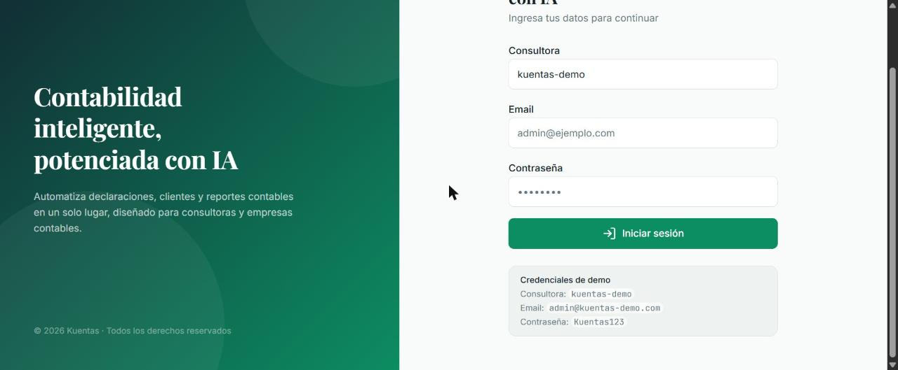

### 1.2 La pantalla principal

Al entrar verá el **Home**, que es el catálogo de módulos del sistema agrupados por
tipo de tarea: mantenciones, registros, libros, informes y utilitarios.

Cada módulo aparece como una tarjeta con su nombre, una descripción breve y su
estado. Los que dicen **Disponible** se pueden usar; los que dicen **Próximamente**
todavía están en desarrollo.

Para entrar a un módulo, haga clic en su tarjeta.

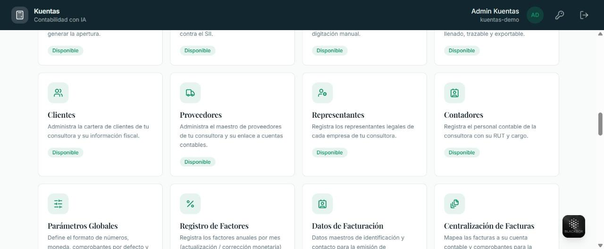

### 1.3 Trabajar con varias empresas

Kuentas es multiempresa: una misma consultora administra la contabilidad de varios
clientes, y los datos de cada uno quedan separados.

Casi todas las pantallas tienen un selector **Empresa** en la parte superior. Al
cambiar de empresa, la información que ve en pantalla cambia por completo: cuentas,
comprobantes, libros e informes.

> **Importante:** antes de registrar cualquier movimiento, verifique que está en la
> empresa correcta.

---

## 2. Puesta en marcha de una empresa

Antes de registrar el primer comprobante hay que dejar lista la empresa. Este
recorrido se hace una sola vez por cliente.

### 2.1 Datos de la empresa

**Módulo: Datos de la Empresa**

Muestra la ficha de la empresa tal como está registrada en el Servicio de Impuestos
Internos: razón social, RUT, representante legal, capital, inicio de actividades y
tipo de régimen.

Estos datos se traen directamente del SII y se muestran **en solo lectura**, para
evitar descuadres tributarios. Si la empresa modificó algo ante el SII, use el botón
**Re-sincronizar** para actualizar la ficha.

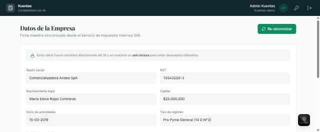

### 2.2 Plan de cuentas

**Módulo: Plan de Cuentas**

Es el catálogo de cuentas de la empresa, ordenado en forma de árbol: cada cuenta
cuelga de un rubro y los códigos siguen la estructura oficial.

Hay dos tipos de cuenta:

- **Cuentas intocables.** Llevan un candado 🔒 y no se pueden editar ni eliminar.
  Son las que exige la normativa tributaria y las que el sistema usa para armar la
  declaración jurada del balance.
- **Cuentas editables.** Las que usted agrega para el detalle de cada empresa.
  Cuelgan de una cuenta madre y se pueden modificar libremente.

Para desplegar o contraer un rubro, haga clic en la flecha que está a su izquierda.

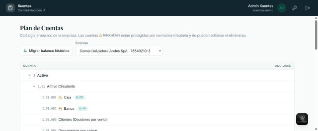

### 2.3 Homologación del balance anterior

**Módulo: Homologación**

Sirve para traer la contabilidad que la empresa tenía en su sistema anterior.

1. Suba el balance histórico del cliente.
2. Mapee cada cuenta antigua a una cuenta del plan de Kuentas.
3. Confirme la migración.

Al confirmar, el sistema genera automáticamente el **Comprobante de Apertura** con
los saldos iniciales. La pantalla muestra un aviso con la fecha en que se confirmó la
migración y el detalle del comprobante generado.

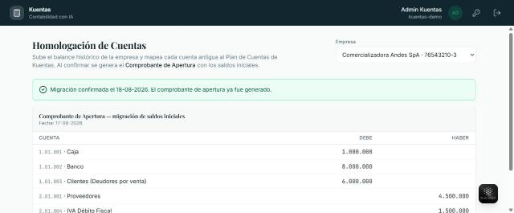

### 2.4 Apertura del ejercicio

**Módulo: Utilitario de Apertura**

Es la alternativa manual a la homologación: permite cargar los saldos iniciales
cuenta por cuenta.

1. Elija la **empresa** y el **año del ejercicio**.
2. Escriba la **glosa**, por ejemplo "Apertura ejercicio 2026".
3. Agregue una línea por cuenta, indicando su saldo en el **Debe** o en el **Haber**.
4. Revise el indicador de **Descuadre**, que debe quedar en cero.
5. Guarde.

> **El asiento debe cuadrar.** Mientras el Debe y el Haber no coincidan, el sistema no
> permite guardar la apertura.

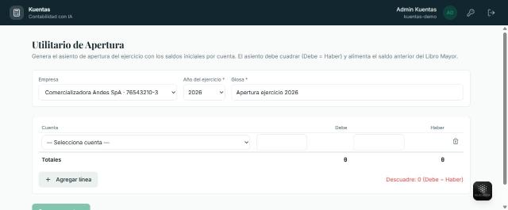

---

## 3. Maestros: con quién trabaja la empresa

Los maestros son los catálogos que alimentan los selectores de los formularios. Se
cargan una vez y se usan en todos los registros.

### 3.1 Clientes y proveedores

**Módulos: Clientes · Proveedores**

Cada registro se identifica por su **RUT** y su **razón social**, y se puede enlazar a
una cuenta contable del plan.

Para agregar uno:

1. Complete el **RUT** y la **razón social**, que son obligatorios.
2. Si quiere, agregue dirección, giro, ciudad y correo.
3. En **Cuenta contable**, presione **Buscar** y elija la cuenta del plan. El nombre de
   la cuenta se completa solo.
4. Presione **Agregar cliente** o **Agregar proveedor**.

El listado de abajo muestra todos los registrados, con botones para editar o eliminar.

> **El RUT no se repite.** Si intenta registrar un RUT que ya existe, el sistema lo
> rechaza. También valida que el RUT sea correcto, incluido su dígito verificador.

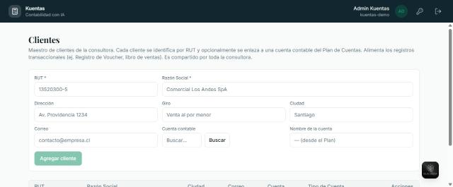

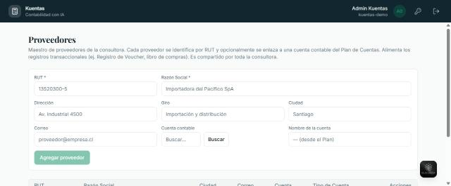

### 3.2 Centros de costo

**Módulo: Centros de Costo**

Permiten saber a qué área de la empresa se carga cada gasto o ingreso, por ejemplo
Ventas o Administración.

Se agregan con un **código** y un **nombre**. Después aparecen como opción en el
registro de comprobantes y en el reporte por centro de costo.

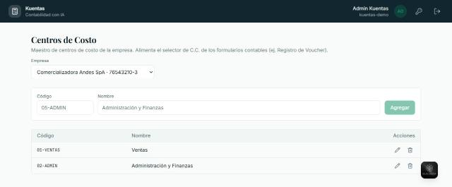

### 3.3 Tipos de documento

**Módulo: Tipo de Documentos**

Es el catálogo de documentos tributarios: factura electrónica, boleta de honorarios y
los demás que use la empresa.

Cada tipo se define con su **nombre**, su **código SII**, una **sigla** y un
**operador**, que indica si el documento suma o resta en los libros.

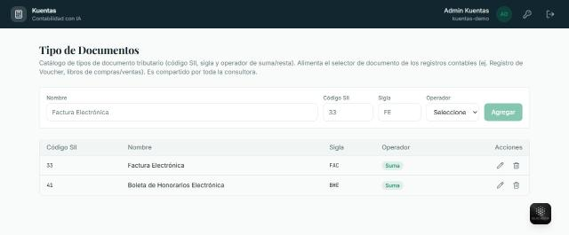

### 3.4 Otros maestros

- **Representantes:** los representantes legales de cada empresa.
- **Contadores:** el personal contable que firma los informes.
- **Parámetros Globales:** formato de números, moneda y folio de los comprobantes.
- **Registro de Factores:** los factores de corrección monetaria por mes.

---

## 4. Registrar movimientos

### 4.1 El comprobante contable

**Módulo: Registro de Voucher**

Es el corazón del sistema: **todo movimiento contable se registra aquí**. Las compras,
las ventas y los honorarios también terminan convertidos en comprobantes, de modo que
los libros y los balances salen siempre del mismo dato.

Para registrar uno:

1. Elija el **período**, el **año** y la **empresa**.
2. Seleccione el **tipo de movimiento**: Ingreso, Egreso o Traspaso.
3. Indique la **fecha** y escriba la **glosa**, que describe el comprobante.
4. Complete las líneas del asiento. En cada una:
   - **Cuenta:** el código de la cuenta del plan.
   - **Centro de costo:** opcional.
   - **Contraparte:** el cliente o proveedor, si corresponde.
   - **T.Doc** y **N°Doc:** el tipo y número de documento, si corresponde.
   - **Debe** o **Haber:** el monto.
5. Si necesita más líneas, presione **Agregar línea**.
6. Revise el pie del formulario: muestra el **Debe**, el **Haber** y la **Diferencia**.
7. Guarde cuando la diferencia sea cero.

> **El comprobante debe cuadrar.** Mientras el total del Debe no sea igual al del
> Haber, la diferencia aparece marcada en rojo y el comprobante no se puede guardar.
> Esta validación es automática y es la que evita los descuadres.

La numeración del comprobante es automática, mensual y por tipo de movimiento.

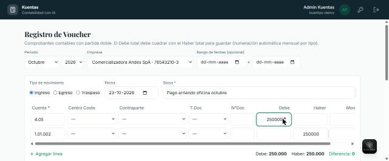

*El comprobante cuadra: la diferencia es cero y se puede guardar.*

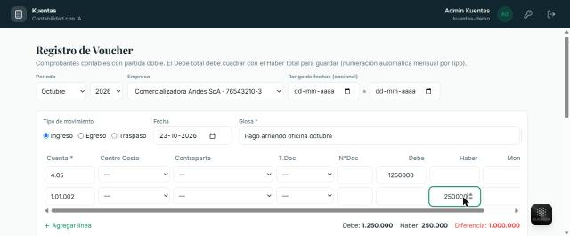

*El comprobante no cuadra: la diferencia aparece en rojo y el sistema impide guardarlo.*

### 4.2 Comprobantes tipo

**Módulo: Plantillas de Voucher**

Sirven para los asientos que se repiten todos los meses: el arriendo, los gastos
comunes, las provisiones.

Para crear uno:

1. Indique el **nombre** de la plantilla, por ejemplo "Arriendo mensual oficina".
2. Elija el **tipo**: Ingreso, Egreso o Traspaso.
3. Escriba la **glosa por defecto**, que se copiará al comprobante.
4. Agregue las líneas con sus cuentas.

> Las plantillas **no exigen que el asiento cuadre**: los montos se completan al
> aplicarla. Al usarla, se precarga un comprobante en el Registro de Voucher, que queda
> editable antes de confirmar.

El catálogo de plantillas es compartido por toda la consultora.

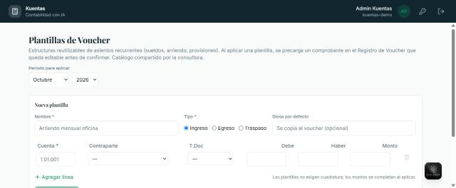

### 4.3 Carga masiva

**Módulo: Importar Voucher Masivo**

Permite subir un archivo con varios comprobantes y crearlos todos de una vez en el
período seleccionado.

---

## 5. Compras, ventas y honorarios

### 5.1 Descargar los documentos desde el SII

**Módulo: Sincronización RCV/BHM**

Trae automáticamente los libros de compras, ventas y boletas de honorarios desde el
Servicio de Impuestos Internos, sin digitación manual.

La pantalla muestra:

- El **estado de la sincronización** y la fecha de la última corrida.
- El **período** a sincronizar, en formato año-mes.
- El botón **Sincronizar ahora**.
- El listado de **documentos sincronizados**, con su libro, tipo de documento, folio,
  contraparte, fecha, total y origen.

Puede filtrar el listado por libro y por origen.

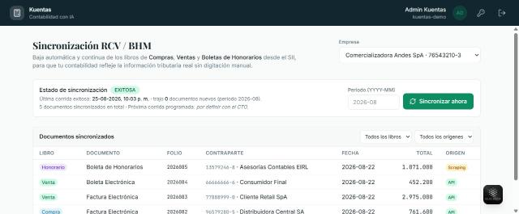

### 5.2 Registrar compras y ventas

**Módulos: Registro de Compras · Registro de Ventas**

Permiten registrar los documentos de compra y de venta con su asiento de partida
doble. Cada documento genera un comprobante que alimenta el Libro de Compras o de
Ventas, el Libro Diario y el Libro Mayor.

1. Elija la **empresa** y el **período**.
2. Presione **Nueva compra** o **Nueva venta**.
3. Complete los datos del documento y su asiento.

Si el período no tiene documentos, la pantalla lo indica y sugiere agregar el primero.

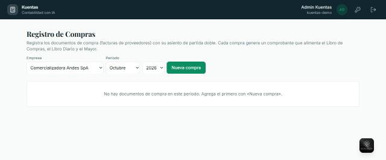

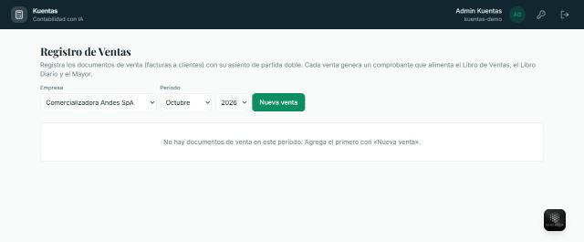

### 5.3 Honorarios

**Módulo: Registro de Honorarios**

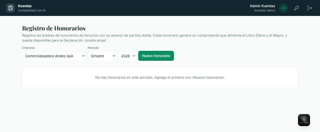

Registra las boletas de honorarios de terceros con su asiento de partida doble. Cada
honorario genera un comprobante y queda disponible para la Declaración Jurada anual.

### 5.4 Notas de crédito

**Módulo: Gestión de Nota de Crédito**

Registra las notas de crédito que corrigen un documento de compra o de venta, con los
datos de la nota y del documento de origen.

> **Atención:** por ahora la nota de crédito queda registrada y vinculada a su
> documento de origen, pero **no genera el asiento contable automáticamente**. El
> asiento debe registrarse a mano en el Registro de Voucher. La propia pantalla lo
> advierte.

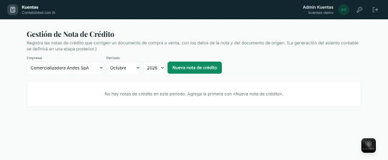

### 5.5 Importar desde un archivo

**Módulos: Importar Libro Compras y Ventas · Importar Libro de Honorarios · Importar Libro de Boletas Electrónicas**

Permiten subir el libro en formato CSV y crear todos los documentos del período de una
vez.

Para importar compras o ventas:

1. Elija la **empresa**, el **período** y el **tipo de libro**.
2. Seleccione la **plantilla** de importación y el **separador** del archivo.
3. Indique las cuentas que se usarán: **cuenta neto**, **cuenta IVA** y **cuenta
   contraparte**.
4. Presione **Elegir archivo CSV** y luego **Importar libro**.

> Las filas cuyo RUT no esté en el maestro de clientes o proveedores **se reportan,
> pero no detienen la carga**.

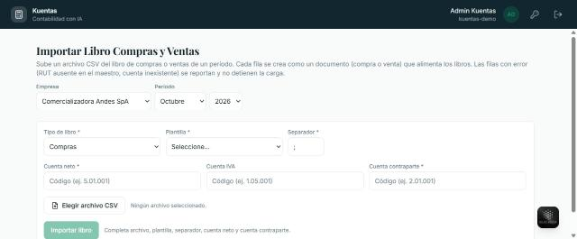

---

## 6. Libros oficiales

Los tres libros son **de solo lectura**: se generan a partir de los comprobantes ya
registrados y se pueden imprimir o guardar como PDF.

### 6.1 Libro Diario

**Módulo: Libro Diario**

Lista en orden cronológico todos los comprobantes del período, con su detalle de
cuentas, glosa y montos en el Debe y el Haber.

1. Elija **empresa**, **mes** y **año**.
2. Ajuste si quiere la **orientación**, el **folio**, las **líneas por página** y el
   **membrete**.
3. Presione **Generar Libro Diario**.

El libro muestra, al final, los **totales del período**, que siempre deben ser iguales
en el Debe y el Haber.

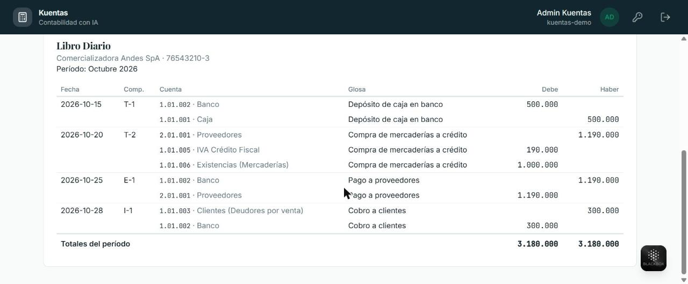

### 6.2 Libro Mayor

**Módulo: Libro Mayor**

Agrupa los movimientos por cuenta y muestra su saldo corrido.

1. Elija **empresa**, **mes** y **año**.
2. Si quiere, filtre por **cuenta** o por **centro de costo**.
3. Presione **Generar Libro Mayor**.

Cada cuenta muestra su **saldo anterior**, los movimientos del período con su fecha,
número de comprobante y glosa, y los **totales de la cuenta**. El número del
comprobante es un enlace: al hacer clic lleva al Registro de Voucher.

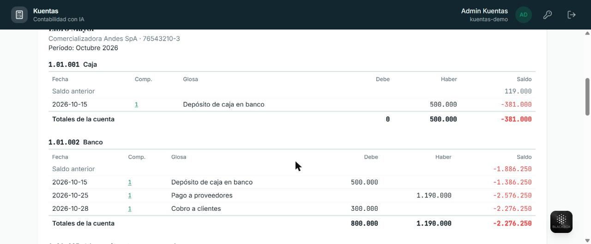

### 6.3 Libro de Compras y Ventas

**Módulo: Libro Compras y Ventas**

Lista los documentos tributarios del período con sus montos neto, IVA y total.

1. Elija **empresa**, **mes** y **año**.
2. Seleccione el **tipo de libro**: Compras o Ventas.
3. Presione **Generar Libro**.

> **Atención:** este libro lista los **documentos tributarios** del período. Un
> movimiento registrado directamente en el Registro de Voucher, sin su documento
> asociado, aparece en el Libro Diario y en el Mayor, pero **no en este libro**. Para
> que aparezca, regístrelo desde Registro de Compras o Registro de Ventas, o
> impórtelo.

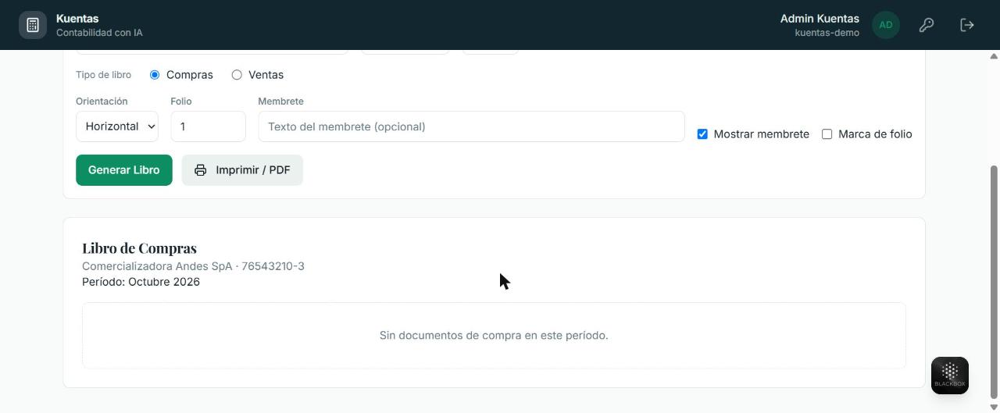

### 6.4 Otros libros

- **Libro de Honorarios:** las boletas del período con sus montos bruto, retención y
  líquido.
- **Libro de Boletas Electrónicas:** las boletas emitidas con su neto, IVA y total.
- **Régimen 14 Ter:** el libro de caja y el de ingresos y egresos del régimen
  simplificado.

---

## 7. Informes y balances

### 7.1 Estado de Resultado

**Módulo: Estado de Resultado**

Presenta los ingresos, los gastos y el resultado del ejercicio.

1. Elija la **empresa** y el **año**, que es obligatorio.
2. Si quiere, acote el rango con **Desde** y **Hasta**, o filtre por centro de costo.
3. Elija la **presentación**: detallado por cuenta, agrupado por cuenta madre o
   resumido con solo los totales.
4. Presione **Generar Estado de Resultado**.

El informe muestra los ingresos con su total, los costos y gastos con su total, y al
final el **resultado del ejercicio**, indicando si es utilidad o pérdida.

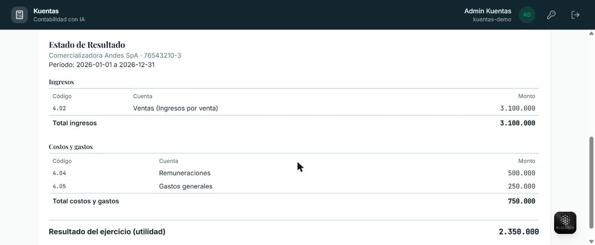

### 7.2 Balance General de 8 columnas

**Módulo: Balance General**

Es el balance de sumas y saldos. Por cada cuenta con movimiento muestra las sumas del
Debe y el Haber, los saldos deudor y acreedor, el inventario de activo y pasivo, y el
resultado de pérdida o ganancia.

1. Elija la **empresa** y el **año**.
2. Ajuste la orientación, el folio y el membrete si lo necesita.
3. Presione **Generar Balance General**.

Las ocho columnas deben cuadrar de a pares. Al final aparece el **resultado del
ejercicio**.

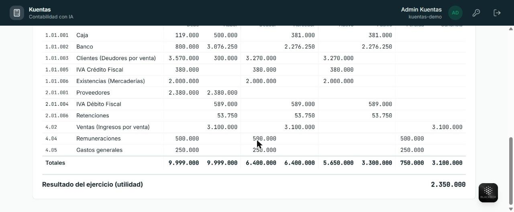

### 7.3 Balance Clasificado

**Módulo: Balance Clasificado**

Presenta el balance agrupado por rubro: activo, pasivo, patrimonio y resultado, cada
uno con su subtotal.

Permite indicar el **representante legal** y el **contador** que firman el documento.

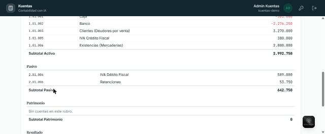

### 7.4 Otros informes

- **Informes Analíticos:** balance de comprobación por cuenta, agrupado por rubro.
- **Reporte de Centro de Costo:** los movimientos del año agrupados por centro, con
  sus totales.
- **Configuración Estado de Resultado:** define qué cuenta va en cada línea del
  informe.

---

## 8. Cierre del período

**Módulo: Cierre de Período**

Calcula la **Renta Líquida Imponible**, aplica la corrección monetaria a las cuentas
designadas y cuadra los retiros del SII contra el balance interno.

La pantalla muestra los períodos de la empresa con su estado: abierto o cerrado. Para
trabajar en un año nuevo, indique el año y presione **Crear**.

> **Antes de cerrar**, el sistema verifica que la contabilidad cuadre. Si hay un
> descuadre, el cierre se bloquea hasta corregirlo.

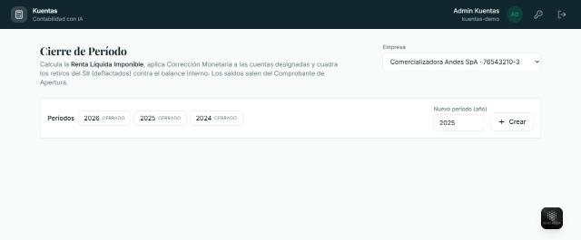

### 8.1 Formulario 22 y Declaraciones Juradas

**Módulo: Formulario 22 y DDJJ**

Mapea cada cuenta del plan a su casilla del Formulario 22 y genera el documento
pre-llenado a partir de los saldos del período cerrado.

La pantalla muestra el avance del mapeo, por ejemplo "0/6 cuentas de resultado
mapeadas", y permite asignar a cada cuenta su casilla F22 y su código de declaración
jurada.

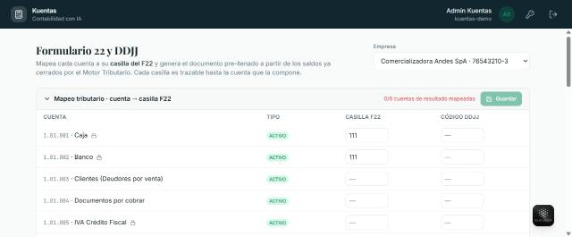

> **Estado actual:** el mapeo tributario de este módulo está en desarrollo y se
> completará en una etapa posterior, una vez validado el catálogo oficial de códigos
> con el equipo contable.

---

## 9. Herramientas de apoyo

| Módulo | Para qué sirve |
|---|---|
| **Generador de Pagos** | Prepara los pagos a proveedores o clientes; cada pago crea su comprobante. |
| **Conciliación Bancaria** | Administra las cartolas por período y muestra su porcentaje de conciliación contra la contabilidad. |
| **Foliador de Hojas** | Genera hojas foliadas correlativas para imprimir los libros timbrados. |
| **Reordenamiento de Comprobantes** | Renumera los comprobantes de un período tras una importación o una eliminación. |
| **Clonar Plan de Cuenta** | Copia el plan completo de una empresa a otra, conservando la jerarquía. |
| **Importar Plan de Cuenta** | Sube el plan en CSV y crea las cuentas derivando nivel y cuenta madre por el código. |
| **Plantillas de Importación** | Define el formato de los archivos que se importan: tipo, separador y columnas. |
| **Centralización de Facturas, Honorarios y Boletas** | Define a qué cuenta y comprobante va cada tipo de documento. |

---

## 10. Preguntas frecuentes

**No puedo guardar el comprobante.**
Revise el pie del formulario: si la **Diferencia** no es cero, el Debe y el Haber no
coinciden. Corrija los montos hasta que la diferencia quede en cero.

**Quiero corregir un monto y se me pegan los números.**
Al escribir sobre un monto ya ingresado, el valor nuevo se suma al anterior en la
misma casilla. Borre primero el contenido con la tecla de retroceso y luego escriba el
monto correcto.

**No puedo editar una cuenta del plan.**
Las cuentas con candado 🔒 son intocables: las exige la normativa tributaria y el
sistema las protege. Si necesita más detalle, cree una subcuenta que cuelgue de ella.

**Registré una compra y no aparece en el Libro de Compras y Ventas.**
Ese libro lista documentos tributarios. Si registró el movimiento directamente como
comprobante, aparecerá en el Libro Diario y en el Mayor, pero no en el libro de
compras. Regístrelo desde el módulo Registro de Compras o impórtelo desde el archivo
del SII.

**La contabilidad de otra empresa aparece vacía.**
Verifique el selector **Empresa** en la parte superior de la pantalla: cada empresa
tiene sus propios datos.

**Entré a una dirección y me devolvió al inicio.**
Si la dirección no corresponde a un módulo existente, el sistema vuelve al Home sin
mostrar un aviso. Entre a los módulos desde las tarjetas del Home.

**¿Dónde quedan guardados los informes?**
Los libros y los informes no se guardan: se generan cada vez a partir de los
comprobantes. Para conservarlos, use la opción **Imprimir / PDF** de cada pantalla.

---

## Anexo · Estado de los módulos

Al cierre de este manual, el sistema tiene **56 módulos operativos**. Tres están
anunciados pero todavía no disponibles: **Declaraciones**, **Automatizaciones AI** y
**Reportes**.

Además, hay funcionalidades que están construidas pero que completarán su
comportamiento en una etapa posterior:

- El asiento automático de la **nota de crédito**.
- El mapeo tributario del **Formulario 22**.
- La ejecución automática de las **centralizaciones**.
- La descarga de documentos reales desde el SII, que hoy opera en modo de demostración.
