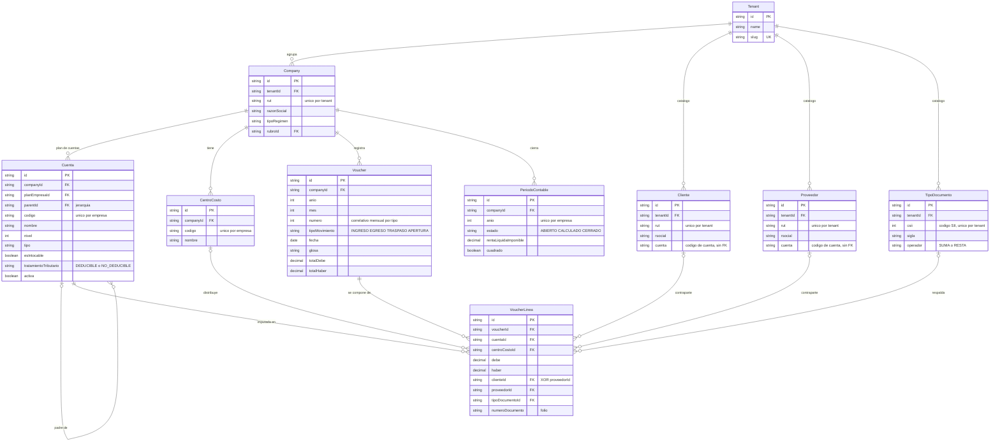
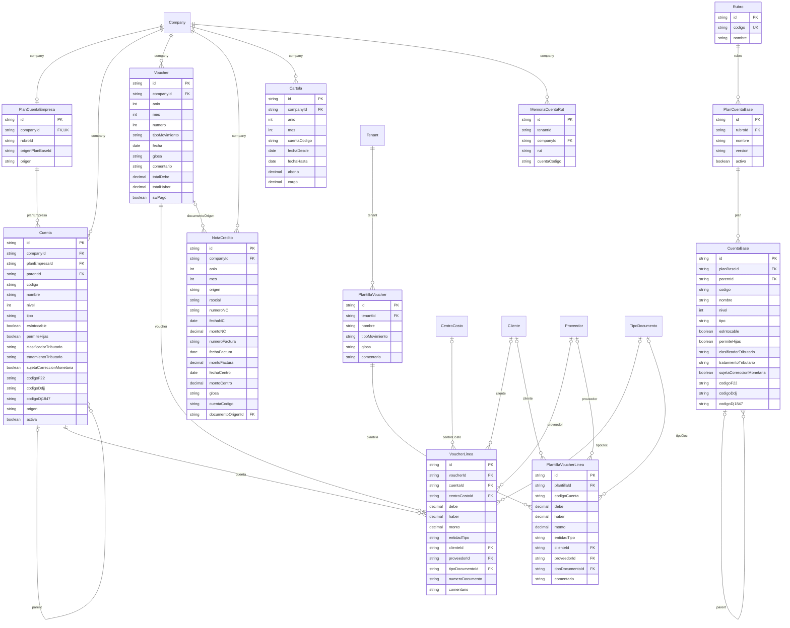
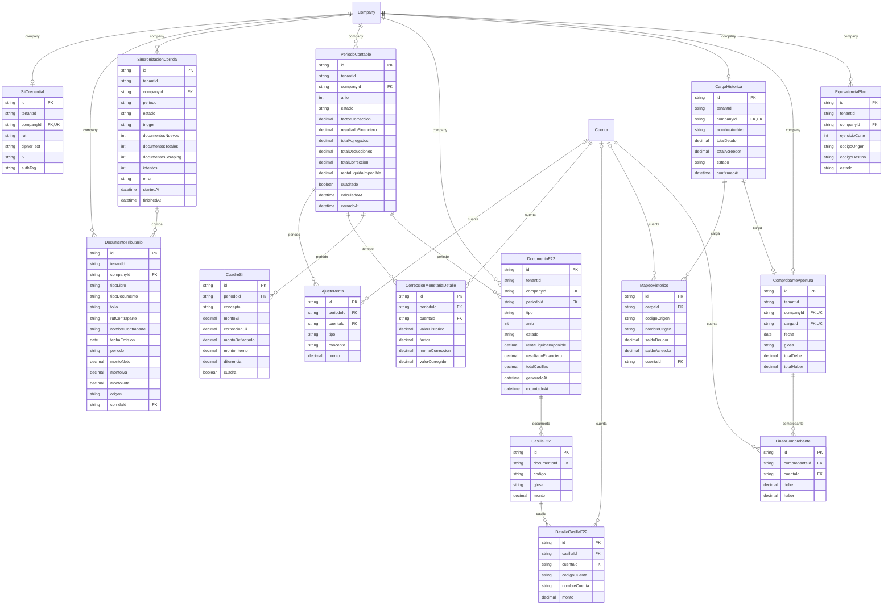

# Modelo de datos de Kuentas

**Fuente:** `kuentas-api/prisma/schema.prisma` y `kuentas-api/prisma/migrations/` en `origin/main` (commit `fd9438b`, 23-10-2026). Motor: PostgreSQL, accedido con el ORM Prisma.

**Alcance:** el schema tiene **46 modelos** (46 tablas). No hay `enum` de Prisma: los dominios cerrados (estados, tipos) son columnas `String` y sus valores válidos solo aparecen en comentarios y en la validación de la API.

> **Nota de versión.** La rama de trabajo local `feat/spec-005-sincronizacion-por-pasos` no coincide con `main`: le faltan `AgenteVinculo` y `User.mustChangePassword`, y agrega 5 columnas y un índice a `SincronizacionCorrida` (migración `20261013150000_spec005_corrida_por_pasos`, todavía sin mergear). Este documento describe **`main`**.

---

## 1. Diagrama del núcleo contable

Son 10 entidades. Para que se lea mejor, los nombres de las relaciones están escritos en lenguaje contable y no con el nombre técnico del campo. Dos claves foráneas apuntan a entidades que no aparecen aquí: `Cuenta.planEmpresaId` → `PlanCuentaEmpresa` y `Company.rubroId` → `Rubro` (ver diagrama 2B y 2A).

**Cómo se lee:**

- **Tenant** es la consultora contable, el cliente del SaaS. **Company** es cada empresa que esa consultora lleva. La separación de datos existe en esos dos niveles (sección 4).
- **Cuenta** es el plan de cuentas *de una empresa*. La jerarquía usa una lista de adyacencia (`parentId`), y `codigo` sirve de ruta ordenable (ej. `1.01.01.01`).
- **Voucher / VoucherLinea** son el comprobante y sus líneas en partida doble. `totalDebe` y `totalHaber` se guardan en la cabecera. La regla Debe = Haber la valida el servicio al guardar, y la exigencia de al menos una línea la valida el DTO (`@ArrayMinSize(1)`). La base de datos no verifica ninguna de las dos; por eso el diagrama dibuja la relación como `o{` (cero o más).
- **PeriodoContable no tiene FK con Voucher.** El período es el cierre tributario anual (`@@unique([companyId, anio])`). Para saber a qué período pertenece un comprobante hay que comparar `Voucher.companyId + anio`; no existe una columna `periodoId`. Por eso no se dibujó una relación entre ambos.
- **Cliente, Proveedor y TipoDocumento son de la consultora (tenant)**, mientras que **Cuenta y CentroCosto son de cada empresa (company)**. Esa diferencia de alcance es intencional y se explica en la sección 6.
- La regla Cliente **XOR** Proveedor en la línea la impone un `CHECK` en la base de datos (migración `20260907180000_spec017_voucher_fks_maestros`): `NOT (cliente_id IS NOT NULL AND proveedor_id IS NOT NULL)`.

---

## 2. Diagrama completo (46 entidades en 3 diagramas)

**Cómo se generaron:** con un script que lee el schema, de modo que los atributos y relaciones son los del código y no se escribieron a mano. Detalles de lectura:

- Están todas las columnas, **menos `createdAt` y `updatedAt`**, que se omiten para aligerar el diagrama (casi todos los modelos las tienen).
- `PK` marca la clave primaria, `FK` una columna con `@relation` y `UK` un `@unique` **de una sola columna**. Las claves únicas compuestas no se pueden dibujar en Mermaid; están en la tabla de la sección 4.
- Cada relación lleva como etiqueta el nombre del campo de relación en Prisma.
- Una caja **sin atributos** es una entidad que se detalla en otro de los tres diagramas.

### 2A. Plataforma, maestros y configuración (19 entidades)

```mermaid
erDiagram
  Tenant {
    string id PK
    string name
    string slug UK
  }
  User {
    string id PK
    string tenantId FK
    string email
    string passwordHash
    string name
    string role
    boolean mustChangePassword
  }
  AgenteVinculo {
    string id PK
    string tenantId FK
    string companyId FK
    string canal
    string externalId
    string nombre
    string codigo UK
    datetime codigoExpira
  }
  Company {
    string id PK
    string tenantId FK
    string rut
    string razonSocial
    string representanteLegal
    decimal capital
    date inicioActividades
    string tipoRegimen
    string actividadEconomica
    string caracteristicas
    string rubroId FK
    datetime syncedAt
  }
  CompanyPartner {
    string id PK
    string companyId FK
    string rut
    string name
    decimal share
  }
  Representante {
    string id PK
    string tenantId FK
    string companyId FK
    string rut
    string nombre
    string correo
  }
  Contador {
    string id PK
    string tenantId FK
    string rut
    string nombre
    string cargo
  }
  Cliente {
    string id PK
    string tenantId FK
    string rut
    string rsocial
    string direccion
    string giro
    string ciudad
    string correo
    string cuenta
    string nombrecuenta
  }
  Proveedor {
    string id PK
    string tenantId FK
    string rut
    string rsocial
    string direccion
    string giro
    string ciudad
    string correo
    string cuenta
    string nombrecuenta
  }
  TipoDocumento {
    string id PK
    string tenantId FK
    string nombre
    int csii
    string sigla
    string operador
  }
  CentroCosto {
    string id PK
    string companyId FK
    string codigo
    string nombre
  }
  Factor {
    string id PK
    string tenantId FK
    int anio
    int mes
    decimal factor
    string glosa
  }
  ParametroGlobal {
    string id PK
    string tenantId FK, UK
    string separadorMiles
    string separadorDecimales
    int cantidadDecimales
    string separadorListas
    string simboloMoneda
    string iva
    string porcentaje
    string factura
    string comprobante1
    string comprobante2
    string comprobante3
    string comprobante4
    int folioActual
    boolean folioActivo
    int filasPorPagina
    string cuentaDefecto
    string nombreCuentaDefecto
  }
  ConfiguracionEResultado {
    string id PK
    string tenantId FK, UK
    string cuenta1Codigo
    string cuenta1Nombre
    string cuenta2Codigo
    string cuenta2Nombre
    boolean asientoPorDefecto
  }
  DatosFacturacion {
    string id PK
    string tenantId FK, UK
    string nombre
    string correo
    string telefono
    string rut
    string rsocial
    string direccion
    string comuna
    string giro
    string cenvio
    string etelefono
  }
  CentralizacionFacturas {
    string id PK
    string tenantId FK, UK
    string cuentaCodigo
    string cuentaNombre
    int comp2
    int comp3
    int comp4
    string dComp2
    string dComp3
    string dComp4
    int venta1
    int venta3
    int venta4
    string dVenta1
    string dVenta3
    string dVenta4
  }
  CentralizacionHonorarios {
    string id PK
    string tenantId FK, UK
    string cuentaCodigo
    string cuentaNombre
    int comp1
    int comp2
    int comp3
    int comp4
    string dComp1
    string dComp2
    string dComp3
    string dComp4
  }
  CentralizacionBoletas {
    string id PK
    string tenantId FK, UK
    string cuentaCodigo
    string cuentaNombre
    int comp1
    int comp2
    int comp3
    int comp4
    string dComp1
    string dComp2
    string dComp3
    string dComp4
  }
  PlantillaImportacion {
    string id PK
    string tenantId FK
    string nombre
    string tipo
    string separador
    string columnas
    string descripcion
  }
  Tenant ||--o{ User : "tenant"
  Tenant ||--o{ AgenteVinculo : "tenant"
  Company ||--o{ AgenteVinculo : "company"
  Tenant ||--o{ Company : "tenant"
  Rubro |o--o{ Company : "rubro"
  Company ||--o{ CompanyPartner : "company"
  Tenant ||--o{ Representante : "tenant"
  Company ||--o{ Representante : "company"
  Tenant ||--o{ Contador : "tenant"
  Tenant ||--o{ Cliente : "tenant"
  Tenant ||--o{ Proveedor : "tenant"
  Tenant ||--o{ TipoDocumento : "tenant"
  Company ||--o{ CentroCosto : "company"
  Tenant ||--o{ Factor : "tenant"
  Tenant ||--o| ParametroGlobal : "tenant"
  Tenant ||--o| ConfiguracionEResultado : "tenant"
  Tenant ||--o| DatosFacturacion : "tenant"
  Tenant ||--o| CentralizacionFacturas : "tenant"
  Tenant ||--o| CentralizacionHonorarios : "tenant"
  Tenant ||--o| CentralizacionBoletas : "tenant"
  Tenant ||--o{ PlantillaImportacion : "tenant"
```

### 2B. Contabilidad: plan de cuentas, comprobantes, plantillas, notas de crédito, cartolas (12 entidades)

### 2C. Tributario e importaciones / migración de saldos (15 entidades)

**Cosas que el diagrama muestra y que conviene saber:**

- `PlanCuentaEmpresa.rubroId` y `origenPlanBaseId` **no son FK** (no tienen `@relation`). Registran la procedencia del plan solo como dato informativo.
- `NotaCredito`, `Cartola`, `MemoriaCuentaRut`, `EquivalenciaPlan` y los modelos de configuración de centralización guardan la cuenta como **código en texto** (`cuentaCodigo`) y no como FK a `Cuenta` (sección 6).
- `DocumentoTributario` (lo descargado del SII) **no tiene FK** hacia `Voucher`, `Cliente` ni `TipoDocumento`. La contraparte se guarda por RUT y el tipo de documento como texto.

---

## 3. Inventario de modelos

**Criterio de conteo:** "Columnas" son los campos escalares, que se convierten en columnas de la tabla (incluye `id`, las FK, `createdAt` y `updatedAt`). "Relaciones" son los campos de navegación de Prisma, que no existen como columna en la base de datos. El área es mi agrupación según los bloques comentados del schema; el schema no define ningún campo "área".

| # | Modelo | Qué representa (para un contador) | Columnas | Relaciones | Área |
|---|---|---|---|---|---|
| 1 | `Tenant` | La consultora o estudio contable que contrata Kuentas | 4 | 17 | Configuración |
| 2 | `User` | Usuario que inicia sesión, de una consultora | 8 | 1 | Configuración |
| 3 | `AgenteVinculo` | Contacto de WhatsApp/Telegram autorizado a consultar una empresa por chat | 10 | 2 | Configuración |
| 4 | `ParametroGlobal` | Preferencias de la consultora: formato numérico, moneda, IVA, folio de comprobantes | 21 | 1 | Configuración |
| 5 | `ConfiguracionEResultado` | Cuentas que mapean el Estado de Resultados | 9 | 1 | Configuración |
| 6 | `DatosFacturacion` | Datos de facturación y contacto de la consultora | 14 | 1 | Configuración |
| 7 | `CentralizacionFacturas` | Cuenta y comprobantes en que se centralizan las facturas de compra/venta | 18 | 1 | Configuración |
| 8 | `CentralizacionHonorarios` | Cuenta y comprobantes en que se centralizan las boletas de honorarios | 14 | 1 | Configuración |
| 9 | `CentralizacionBoletas` | Cuenta y comprobantes en que se centralizan las boletas electrónicas | 14 | 1 | Configuración |
| 10 | `Company` | La empresa contribuyente cuya contabilidad se lleva (datos del SII) | 14 | 20 | Maestros |
| 11 | `CompanyPartner` | Socio de la empresa y su porcentaje de participación | 6 | 1 | Maestros |
| 12 | `Representante` | Representante legal de una empresa | 8 | 2 | Maestros |
| 13 | `Contador` | Contador del equipo de la consultora | 7 | 1 | Maestros |
| 14 | `Cliente` | Cliente (contraparte de ventas), compartido por las empresas de la consultora | 12 | 3 | Maestros |
| 15 | `Proveedor` | Proveedor (contraparte de compras y honorarios) | 12 | 3 | Maestros |
| 16 | `TipoDocumento` | Tipo de documento tributario (código SII 33, 34, 61…) y si suma o resta | 8 | 3 | Maestros |
| 17 | `CentroCosto` | Centro de costo de una empresa | 6 | 2 | Maestros |
| 18 | `Factor` | Factor de actualización mensual (corrección monetaria) por año | 8 | 1 | Maestros |
| 19 | `Rubro` | Giro económico que determina qué plan de cuentas base se usa | 4 | 2 | Contabilidad |
| 20 | `PlanCuentaBase` | Plan de cuentas modelo (plantilla maestra) de un rubro | 6 | 2 | Contabilidad |
| 21 | `CuentaBase` | Cuenta del plan modelo, con su mapeo tributario (F22, DJ 1847) | 15 | 3 | Contabilidad |
| 22 | `PlanCuentaEmpresa` | De qué plantilla se copió el plan de cuentas de la empresa | 6 | 2 | Contabilidad |
| 23 | `Cuenta` | Cuenta del plan de cuentas de la empresa (imputable o de agrupación) | 20 | 10 | Contabilidad |
| 24 | `Voucher` | Comprobante contable (asiento) de ingreso, egreso, traspaso o apertura | 14 | 3 | Contabilidad |
| 25 | `VoucherLinea` | Línea del comprobante: cuenta, Debe/Haber, centro de costo, contraparte, documento | 13 | 6 | Contabilidad |
| 26 | `PlantillaVoucher` | Asiento tipo o recurrente (sueldos, arriendo) que precarga un comprobante | 8 | 2 | Contabilidad |
| 27 | `PlantillaVoucherLinea` | Línea del asiento tipo | 11 | 4 | Contabilidad |
| 28 | `NotaCredito` | Nota de crédito que corrige una compra o venta anterior | 19 | 2 | Contabilidad |
| 29 | `Cartola` | Resumen de la cartola bancaria del mes, para la conciliación | 11 | 1 | Contabilidad |
| 30 | `MemoriaCuentaRut` | "Este proveedor siempre va a esta cuenta de gasto" (contabilización asistida) | 7 | 1 | Contabilidad |
| 31 | `SiiCredential` | Clave tributaria del SII de la empresa, cifrada | 9 | 1 | Tributario |
| 32 | `DocumentoTributario` | Factura o boleta descargada del Registro de Compras y Ventas / BHE del SII | 17 | 2 | Tributario |
| 33 | `SincronizacionCorrida` | Registro de cada descarga desde el SII (cuándo, cuántos documentos, errores) | 13 | 2 | Tributario |
| 34 | `PeriodoContable` | Cierre tributario anual: RLI, corrección monetaria, cuadre con el SII | 16 | 5 | Tributario |
| 35 | `AjusteRenta` | Agregado o deducción a la RLI (ej. gasto rechazado) | 6 | 2 | Tributario |
| 36 | `CorreccionMonetariaDetalle` | Corrección monetaria de una cuenta: valor histórico vs. corregido | 7 | 2 | Tributario |
| 37 | `CuadreSii` | Comparación de un concepto (ej. retiros) entre el SII deflactado y la contabilidad | 9 | 1 | Tributario |
| 38 | `DocumentoF22` | Formulario 22 (o DDJJ) generado para un año, guardado como foto fija | 14 | 3 | Tributario |
| 39 | `CasillaF22` | Casilla del F22 con su monto | 5 | 2 | Tributario |
| 40 | `DetalleCasillaF22` | Qué cuentas componen el monto de una casilla (trazabilidad) | 6 | 2 | Tributario |
| 41 | `CargaHistorica` | Balance del sistema anterior subido para migrar la contabilidad | 9 | 3 | Importaciones |
| 42 | `MapeoHistorico` | Homologación: cuenta del sistema anterior → cuenta de Kuentas | 9 | 2 | Importaciones |
| 43 | `ComprobanteApertura` | Asiento de apertura generado desde el balance migrado | 9 | 3 | Importaciones |
| 44 | `LineaComprobante` | Línea del asiento de apertura | 5 | 2 | Importaciones |
| 45 | `EquivalenciaPlan` | Equivalencia entre el plan de cuentas antiguo y el nuevo desde un ejercicio de corte | 9 | 1 | Importaciones |
| 46 | `PlantillaImportacion` | Formato de columnas de un archivo para cargas masivas (compras, ventas, plan…) | 9 | 1 | Importaciones |

**Totales por área:** Configuración 9, Maestros 9, Contabilidad 12, Tributario 10, Importaciones 6. En total son **479 columnas**.

---

## 4. Aislamiento multiempresa

### 4.1 Dos niveles de separación

Kuentas separa datos en dos niveles, uno dentro del otro:

1. **`tenantId`**: separa una **consultora** de otra. Es el límite de seguridad del SaaS.
2. **`companyId`**: separa las **empresas** que lleva una misma consultora (y cada `Company` tiene a su vez un `tenantId`).

El `tenantId` **no se recibe del cliente**: se obtiene del token JWT. En `JwtStrategy.validate` (`kuentas-api/src/modules/auth/strategies/jwt.strategy.ts`), si el token no trae `tenantId` se rechaza con `401`. Los controladores lo leen con el decorador `@CurrentUser('tenantId')`. El `companyId` sí viene en la URL (`/companies/:companyId/...`), así que **siempre se comprueba que la empresa pertenezca al tenant** antes de usarlo.

### 4.2 En qué modelos está cada campo

| Patrón | Modelos |
|---|---|
| **Solo `tenantId`** (catálogo o configuración de la consultora) | `User`, `Company`, `Cliente`, `Proveedor`, `TipoDocumento`, `Contador`, `Factor`, `PlantillaVoucher`, `PlantillaImportacion`, `ParametroGlobal`, `ConfiguracionEResultado`, `DatosFacturacion`, `CentralizacionFacturas`, `CentralizacionHonorarios`, `CentralizacionBoletas` (15) |
| **Solo `companyId`** (el tenant se obtiene por `company.tenantId`) | `CompanyPartner`, `PlanCuentaEmpresa`, `Cuenta`, `CentroCosto`, `Voucher`, `NotaCredito`, `Cartola` (7) |
| **Ambos** (`tenantId` duplicado junto a `companyId`) | `AgenteVinculo`, `Representante`, `SiiCredential`, `MemoriaCuentaRut`, `CargaHistorica`, `ComprobanteApertura`, `EquivalenciaPlan`, `PeriodoContable`, `DocumentoTributario`, `SincronizacionCorrida`, `DocumentoF22` (11) |
| **Ninguno**: tabla hija que hereda el alcance de su cabecera | `VoucherLinea`, `PlantillaVoucherLinea`, `MapeoHistorico`, `LineaComprobante`, `AjusteRenta`, `CorreccionMonetariaDetalle`, `CuadreSii`, `CasillaF22`, `DetalleCasillaF22` (9) |
| **Ninguno**: catálogo global compartido | `Rubro`, `PlanCuentaBase`, `CuentaBase` (3) |
| Raíz | `Tenant` (1) |

**Ojo con el grupo "Ambos":** solo `AgenteVinculo` y `Representante` declaran `tenantId` como FK real hacia `Tenant`. En los otros 9 es una **columna sin restricción de integridad**, es decir, desnormalizada. La base de datos no garantiza que coincida con `company.tenantId`; esa coherencia depende de que la aplicación la escriba bien.

### 4.3 Índices compuestos

**Claves únicas que incluyen el campo de aislamiento** (garantizan unicidad *dentro* del tenant o de la empresa, no a nivel global):

| Ámbito | Clave única |
|---|---|
| Tenant | `User(tenantId, email)`, `Company(tenantId, rut)`, `Cliente(tenantId, rut)`, `Proveedor(tenantId, rut)`, `Contador(tenantId, rut)`, `TipoDocumento(tenantId, csii)`, `PlantillaVoucher(tenantId, nombre)`, `PlantillaImportacion(tenantId, nombre)`, `Factor(tenantId, anio, mes)` |
| Tenant (singleton) | `tenantId @unique` en `ParametroGlobal`, `ConfiguracionEResultado`, `DatosFacturacion`, `CentralizacionFacturas`, `CentralizacionHonorarios`, `CentralizacionBoletas` |
| Empresa | `Cuenta(companyId, codigo)`, `CentroCosto(companyId, codigo)`, `Representante(companyId, rut)`, `MemoriaCuentaRut(companyId, rut)`, `PeriodoContable(companyId, anio)`, `DocumentoF22(companyId, anio, tipo)`, `EquivalenciaPlan(companyId, ejercicioCorte, codigoOrigen)`, `Voucher(companyId, anio, mes, tipoMovimiento, numero)`, `DocumentoTributario(companyId, tipoLibro, tipoDocumento, folio, rutContraparte)` |
| Empresa (1 a 1) | `companyId @unique` en `SiiCredential`, `PlanCuentaEmpresa`, `CargaHistorica`, `ComprobanteApertura` |
| Sin campo de aislamiento | `AgenteVinculo(canal, externalId)`, global a propósito: un número de WhatsApp o chat de Telegram apunta a una sola empresa de todo el sistema |

**Índices compuestos no únicos** (para rendimiento): `Voucher(companyId, anio, mes)`, `NotaCredito(companyId, anio, mes)`, `Cartola(companyId, anio, mes)`, `DocumentoTributario(companyId, tipoLibro)` y `(companyId, periodo)`, `SincronizacionCorrida(companyId, startedAt)`, `Factor(tenantId, anio)` y `AgenteVinculo(tenantId, companyId)`. Además, muchos modelos tienen un índice simple sobre `tenantId` o `companyId`.

### 4.4 Cómo se evita que una consulta mezcle datos de dos clientes

**El aislamiento se hace en la aplicación, no en la base de datos.** Revisé el código y confirmé lo siguiente:

- **No hay Row-Level Security (RLS)** de PostgreSQL: ninguna migración contiene `ROW LEVEL SECURITY` ni `POLICY`.
- **No hay filtro automático en el ORM**: `PrismaService` (`kuentas-api/src/shared/database/prisma.service.ts`) es un `PrismaClient` sin `$extends` ni middleware que agregue `tenantId` por sí solo.
- **Lo que sí existe es una convención que se aplica en cada servicio**:
  1. Para recursos de una empresa: `assertCompanyOwned(tenantId, companyId)` hace `company.findFirst({ where: { id: companyId, tenantId } })` y responde `404` si la empresa no es de la consultora (ej. `vouchers.service.ts:515`).
  2. Para buscar por id: el filtro incluye la relación, `where: { id, company: { tenantId } }`. Así, un id de otra consultora da "no encontrado" en vez de devolver datos ajenos.
  3. Para catálogos de la consultora: `where: { tenantId }` directo.
  4. **Referencias entre niveles**: una `VoucherLinea` (empresa) apunta a `Cliente`, `Proveedor` y `TipoDocumento` (tenant). La FK solo asegura que el registro *exista*, no que sea de la *misma* consultora. Por eso `VouchersService.assertMaestrosDelTenant` lo valida de forma explícita (el comentario en `vouchers.service.ts` lo dice: "la cadena línea→voucher→empresa→tenant no cabe en una sola FK"). Del mismo modo, las cuentas y los centros de costo se resuelven con `where: { companyId, ... }`.
- **Respaldo en la base de datos**: las claves únicas compuestas de 4.3 y el borrado en cascada desde `Tenant` y `Company` (`onDelete: Cascade`) evitan que queden datos huérfanos sin dueño.

**Limitación para la defensa:** como la protección depende de que cada consulta incluya el filtro, un servicio nuevo que lo olvide podría filtrar datos de otro cliente; la base de datos no lo impediría. Hay dos mitigaciones posibles, ninguna implementada hoy: RLS con `SET app.tenant_id` por transacción, o una extensión de Prisma que inyecte el filtro.

---

## 5. Migraciones

En `main` hay **36 carpetas** (35 con fecha + `0_init`). El nombre es la marca de tiempo `AAAAMMDDhhmmss` seguida de una descripción. Prisma las aplica en orden lexicográfico. En producción (Cloud Run) solo se ejecuta `prisma migrate deploy`, nunca el seed. Por eso los datos de catálogo se siembran mediante **migraciones de datos** (marcadas como "datos" en la tabla).

### Sin fecha

| Carpeta | Spec | Qué hace |
|---|---|---|
| `0_init` | Base | Crea `tenants` y `users` (login multi-tenant) |

### Agosto 2026: fundación (8)

| Fecha | Carpeta | Spec | Qué hace |
|---|---|---|---|
| 17-08 | `20260817000000_onboarding_sii` | SPEC-001 | `companies`, `company_partners`, `sii_credentials` |
| 17-08 | `20260817000000_spec002_plan_de_cuentas` | SPEC-002 | `rubros`, `planes_cuenta_base`, `cuentas_base`, `cuentas` y `planes_cuenta_tenant` |
| 18-08 | `20260818000000_plan_cuentas_por_empresa` | SPEC-002 | **Cambio de alcance del plan de cuentas de tenant a empresa**: elimina `planes_cuenta_tenant`, crea `planes_cuenta_empresa` |
| 18-08 | `20260818120000_spec003_homologacion_balance_historico` | SPEC-003 | `cargas_historicas`, `mapeos_historicos`, `comprobantes_apertura`, `lineas_comprobante` |
| 18-08 | `20260818130000_seed_catalogo_base_y_provision` | SPEC-002/003 | **Datos**: siembra el catálogo base y asigna plan de cuentas a las empresas existentes |
| 19-08 | `20260819000000_spec004_motor_tributario` | SPEC-004 | `periodos_contables`, `ajustes_renta`, `correcciones_monetarias`, `cuadres_sii` y columnas tributarias en `cuentas` |
| 20-08 | `20260820000000_spec005_sincronizacion_rcv_bhm` | SPEC-005 | `documentos_tributarios`, `sincronizacion_corridas` |
| 20-08 | `20260820120000_spec006_formulario_22` | SPEC-006 | `documentos_f22`, `casillas_f22`, `detalles_casilla_f22` y `codigo_f22` / `codigo_ddjj` en cuentas |

### Septiembre 2026: clonación de MasContable (23)

| Fecha | Carpeta | Spec | Qué hace |
|---|---|---|---|
| 02-09 | `20260902120000_spec015_centros_costo` | SPEC-015 | `centros_costo` |
| 02-09 | `20260902130000_spec017_registro_voucher` | SPEC-017 | `vouchers`, `voucher_lineas` |
| 03-09 | `20260903120000_spec014_tipo_documentos` | SPEC-014 | `tipos_documento` |
| 03-09 | `20260903130000_spec011_clientes` | SPEC-011 | `clientes` |
| 03-09 | `20260903140000_spec012_proveedores` | SPEC-012 | `proveedores` |
| 03-09 | `20260903150000_spec010_representantes` | SPEC-010 | `representantes` |
| 04-09 | `20260904160000_spec041_parametros_globales` | SPEC-041 | `parametros_globales` |
| 07-09 | `20260907120000_spec016_contadores` | SPEC-016 | `contadores` |
| 07-09 | `20260907180000_spec017_voucher_fks_maestros` | SPEC-017 | Las líneas pasan de texto libre (`razon_social`) a FK con Cliente/Proveedor/TipoDocumento, más `CHECK` XOR |
| 07-09 | `20260907190000_spec018_plantillas_voucher` | SPEC-018 | `plantillas_voucher`, `plantilla_voucher_lineas` (con `CHECK` XOR) |
| 09-09 | `20260909120000_spec053_voucher_sw_pago` | SPEC-053 | `vouchers.sw_pago` |
| 11-09 | `20260911120000_spec044_config_eerr` | SPEC-044 | `configuracion_estado_resultado` |
| 16-09 | `20260916120000_spec042_factores` | SPEC-042 | `factores` |
| 16-09 | `20260916140000_spec048_datos_facturacion` | SPEC-048 | `datos_facturacion` |
| 16-09 | `20260916150000_spec045_centralizacion_facturas` | SPEC-045 | `centralizacion_facturas` |
| 16-09 | `20260916160000_spec046_centralizacion_honorarios` | SPEC-046 | `centralizacion_honorarios` |
| 16-09 | `20260916170000_spec047_centralizacion_boletas` | SPEC-047 | `centralizacion_boletas` |
| 16-09 | `20260916180000_spec038_nota_credito` | SPEC-038 | `notas_credito` |
| 16-09 | `20260916190000_spec011_012_cuenta_codigo_string` | SPEC-011/012 | `clientes.cuenta` y `proveedores.cuenta` cambian de entero a texto (códigos con puntos) |
| 17-09 | `20260917013422_spec002_codigo_dj1847` | SPEC-002 | `codigo_dj1847` en `cuentas` y `cuentas_base` |
| 21-09 | `20260921140000_spec040_cartola` | SPEC-040 | `cartolas` |
| 21-09 | `20260921160000_spec043_plantillas_importacion` | SPEC-043 | `plantillas_importacion` |
| 29-09 | `20260929000000_spec002_plan_cuentas_real_generico` | SPEC-002 | **Datos**: siembra el plan de cuentas base real (305 cuentas) |

### Octubre 2026: lógica real post-clonación (4)

| Fecha | Carpeta | Spec | Qué hace |
|---|---|---|---|
| 02-10 | `20261002120000_spec002_fase_c_equivalencia_plan` | SPEC-002 Fase C | `equivalencias_plan` y `cuentas.activa` |
| 07-10 | `20261007120000_spec073_memoria_cuenta_rut` | SPEC-073 | `memoria_cuenta_rut` |
| 14-10 | `20261014120000_user_must_change_password` | Alta de cliente piloto (sin número de spec) | `users.must_change_password` |
| 15-10 | `20261015003653_spec081_agente_vinculos` | SPEC-081 | `agente_vinculos` |

Pendiente, fuera de `main`: `20261013150000_spec005_corrida_por_pasos` (SPEC-005, en la rama local).

**Observaciones:**

- Dos migraciones comparten la marca `20260817000000`. Prisma las ordena alfabéticamente (`onboarding_sii` antes que `spec002_…`), así que el resultado es determinista.
- **Septiembre es el mes de la clonación de pantallas de MasContable**: casi cada spec agrega una tabla. **Octubre** es el de la lógica de negocio real.
- Las migraciones son **aditivas**. La única destructiva es `20260818000000`, que borró datos de plan de prueba al cambiar el alcance. Lo dice su propio comentario y es una buena evidencia de cómo evolucionó el diseño (sección 6).

---

## 6. Decisiones de diseño

### 6.1 Compras, ventas y honorarios se registran como comprobantes, sin tablas propias

**Qué hay en el código:** no existen tablas `compras`, `ventas` ni `honorarios`. Los módulos `registro-compras`, `registro-ventas` y `registro-honorarios`, junto con los importadores masivos (`importar-compraventa`, `importar-honorarios`, `importar-boletas`), llaman todos a `VouchersService.create(...)`. El comentario de `registro-compras.service.ts` lo dice así: *"NO crea entidades propias: es una vista/alta especializada sobre el Voucher (SPEC-017)"*.

**Cómo se reconoce cada tipo de documento, a partir de las líneas:**

| Documento | Criterio en el código |
|---|---|
| Compra | Voucher con ≥ 1 línea con `proveedorId` (por defecto `EGRESO`) |
| Venta | Voucher con ≥ 1 línea con `clienteId` |
| Honorario | Voucher con línea de `proveedorId` **y** un `TipoDocumento` cuya sigla o nombre coincide con `/honorario\|BHE\|BHM/i` |
| Apertura (SPEC-054) | Voucher con `tipoMovimiento = 'APERTURA'` |

**Por qué conviene (argumentos para la defensa):**

1. **Una sola fuente de verdad contable.** Todo hecho económico termina como asiento en partida doble. El Libro Diario, el Libro Mayor, los balances (8 columnas y clasificado), el Estado de Resultados y el Libro de Compras y Ventas leen la **misma** tabla `voucher_lineas` (`libros.service.ts`). Una compra nueva aparece en todos ellos sin escribir código extra.
2. **Las reglas contables se implementan una sola vez.** Cuadratura Debe = Haber, correlativo mensual por tipo, validación de cuentas imputables y activas, centros de costo de la empresa, coherencia de tenant y XOR de contraparte: todo vive en `VouchersService`. Con tablas separadas habría que repetir y mantener esa lógica cuatro veces.
3. **No hay doble registro ni conciliación interna.** Si existieran una tabla `compras` y su asiento por separado, podrían desincronizarse, y además habría que conciliarlas entre sí.

**Costos o limitaciones que conviene reconocer:**

- **El tipo de documento se deduce, no se declara.** `Voucher` no tiene una columna como `origen = COMPRA | VENTA | HONORARIO`. Una compra y un honorario son iguales a nivel de datos (los dos tienen proveedor), y el Libro de Honorarios los distingue con una heurística sobre el texto del tipo de documento. El propio código lo reconoce como "pragmatismo (§8 / duda D5 con Claudio)". Una mejora natural sería agregar un discriminador explícito.
- **Los datos propios del documento** (neto, IVA y total por separado, fecha de vencimiento) no tienen columna: se representan como líneas imputadas a cuentas de IVA, etc. El folio (`numeroDocumento`) sí está en la línea.
- **`tipoMovimiento` es texto libre.** El comentario del schema dice `INGRESO | EGRESO | TRASPASO`, pero el código también escribe `APERTURA`. Ningún `CHECK` ni `enum` restringe los valores.
- **Todavía coexisten dos fuentes de saldos.** El documento tributario descargado del SII (`DocumentoTributario`) está separado del asiento: la contabilización asistida (SPEC-073) lo convierte en Voucher cuando el usuario confirma. Además, el Motor Tributario (SPEC-004) calcula sus saldos desde `ComprobanteApertura`, no desde los vouchers (`tributario.service.ts`, `getSaldos`: *"no hay libro mayor todavía"*). Es una deuda de unificación pendiente.

### 6.2 Configuración única por empresa: en realidad es por tenant (consultora)

Estos son los modelos con el patrón *singleton* (una fila como máximo), que se implementa con `tenantId @unique` y una relación 1:1 opcional (`Tenant.parametroGlobal ParametroGlobal?`):

| Modelo | Spec |
|---|---|
| `ParametroGlobal` | SPEC-041 |
| `ConfiguracionEResultado` | SPEC-044 |
| `DatosFacturacion` | SPEC-048 |
| `CentralizacionFacturas` | SPEC-045 |
| `CentralizacionHonorarios` | SPEC-046 |
| `CentralizacionBoletas` | SPEC-047 |

**Aclaración importante:** estas configuraciones son **por consultora, no por empresa**. Las 20 empresas de una consultora comparten la misma configuración de centralización. Es lo que dice el spec, pero es un punto discutible: dos empresas con planes de cuentas distintos podrían necesitar cuentas de centralización distintas.

Hay otro grupo que también es 1:1, pero **por empresa** (`companyId @unique`): `SiiCredential` (una clave SII por empresa), `PlanCuentaEmpresa` (un plan por empresa), `CargaHistorica` y `ComprobanteApertura` (una migración inicial por empresa).

Detalle de implementación de los singletons: los campos de la configuración son *nullable* en la base de datos aunque el spec diga que son obligatorios (ej. `CentralizacionHonorarios.comp1..4`). La obligatoriedad se valida en el DTO, de modo que una consultora sin configuración simplemente no tiene fila.

### 6.3 Otras decisiones que vale la pena destacar

1. **Plantilla maestra vs. copia editable (plan de cuentas).** `CuentaBase` es el catálogo global y no se puede editar (RN-01). Al crear una empresa se **copia** a `Cuenta`, donde el contador puede agregar cuentas hijas. Una ventaja: cambiar la plantilla no altera la contabilidad ya registrada. Las cuentas marcadas `esIntocable` (Caja, Bancos, IVA y otras críticas) no pueden cambiar su estructura.

2. **El plan de cuentas es por empresa y no por consultora.** Así se decidió al principio y luego **se corrigió**: SPEC-002 lo creó por tenant (`planes_cuenta_tenant`) y al día siguiente la migración `20260818000000_plan_cuentas_por_empresa` lo cambió a `Company`. Es un buen caso de evolución del modelo para presentar en la defensa.

3. **Alcance distinto según el maestro.** Clientes, proveedores, tipos de documento y plantillas son de la **consultora**, porque un mismo proveedor (ej. una distribuidora eléctrica) aparece en varias empresas y conviene registrarlo una vez. En cambio, cuentas y centros de costo son de **cada empresa**, porque su estructura contable es propia. La consecuencia es que la FK sola no basta para aislar datos (sección 4.4).

4. **Referenciar cuentas por código en vez de por FK**, en configuraciones y plantillas (`cuentaCodigo`, `codigoCuenta` en `PlantillaVoucherLinea`, `cuenta` en Cliente/Proveedor). Como el plan es por empresa y la configuración por consultora, no hay un único `cuentaId` al que apuntar. El código (`1.01.01.01`) es estable entre empresas y se traduce a la cuenta concreta al aplicarlo. A cambio, la base de datos no puede asegurar que ese código exista.

5. **`onDelete` según el valor histórico del dato.**
   - `Restrict` en `VoucherLinea → Cliente/Proveedor/TipoDocumento` y en `VoucherLinea → Cuenta` (FK sin `onDelete`, que en Prisma equivale a Restrict): no se puede borrar un maestro o una cuenta que ya tiene asientos.
   - `SetNull` en `PlantillaVoucherLinea` (una plantilla no es un registro contable) y en las trazabilidades (`MapeoHistorico.cuentaId`, `DetalleCasillaF22.cuentaId`).
   - `Cascade` desde `Tenant` y `Company`, para dar de baja un cliente por completo.

6. **Cuentas retiradas en lugar de borradas (`Cuenta.activa`).** Al pasar al plan de cuentas real desde un ejercicio de corte, las cuentas antiguas quedan `activa = false`: ya no se ofrecen para nuevos asientos, pero se conservan para los informes de años anteriores (`EquivalenciaPlan` registra la correspondencia antiguo → nuevo).

7. **Fotos fijas (snapshots) para documentos tributarios.** `DocumentoF22` / `CasillaF22` / `DetalleCasillaF22` guardan los montos **y** el código y nombre de la cuenta en el momento de generarse. Así el F22 puede volver a exportarse igual aunque después cambien los saldos o se borre una cuenta. Lo mismo hacen `PeriodoContable` (guarda RLI, agregados y deducciones) y `CorreccionMonetariaDetalle` (valor histórico y corregido).

8. **Descarga del SII idempotente.** La clave única de 5 columnas `documentos_tributarios_identidad_sii_key` (`companyId, tipoLibro, tipoDocumento, folio, rutContraparte`) identifica un documento en el SII, de modo que volver a sincronizar hace *upsert* sin crear duplicados. El nombre se definió a mano porque el generado automáticamente superaba el límite de 63 caracteres de PostgreSQL.

9. **Seguridad de la credencial SII.** `SiiCredential` guarda `cipherText`, `iv` y `authTag` (cifrado AES-256-GCM); la clave maestra vive en una variable de entorno y nunca en la base de datos. Solo se guarda después de una autenticación exitosa.

10. **Importes en `Decimal(18,2)` y factores en `Decimal(10,6)`**, nunca `Float`, para evitar errores de redondeo en cálculos contables. Los factores usan la misma precisión en `Factor` y en el Motor Tributario, de modo que son intercambiables.

11. **Correlativo de comprobantes** por empresa, año, mes **y tipo**: `@@unique([companyId, anio, mes, tipoMovimiento, numero])`. Coincide con la práctica habitual en Chile de llevar series separadas para ingresos, egresos y traspasos.

### 6.4 Cosas que el código no deja claras (para no afirmarlas en la defensa)

- **La semántica de varios campos de configuración está "por validar con Claudio" (§8)**: qué representa cada `comp1..4` de las centralizaciones, `asientoPorDefecto` en el EERR, `ParametroGlobal.iva`, y `fechaCentro` / `montoCentro` en `NotaCredito`. Se copió la estructura de MasContable sin cerrar su significado.
- **Los códigos F22 / DJ** (`codigoF22`, `codigoDdjj`, `codigoDj1847`): según el comentario del schema, solo la Casilla 111 (Caja/Banco) está confirmada.
- **La nota de crédito no genera asiento** (comentario de SPEC-038: se dejó para una segunda pasada). En la rama del PR #100, la NC resta en el Libro de Compras y Ventas, pero ese PR no está en `main`.
- **`User.role`** es un `String` con valor por defecto `"admin"`; no existe todavía un modelo de roles o permisos (RBAC está especificado en la Fase 7, pero no implementado en el schema).
